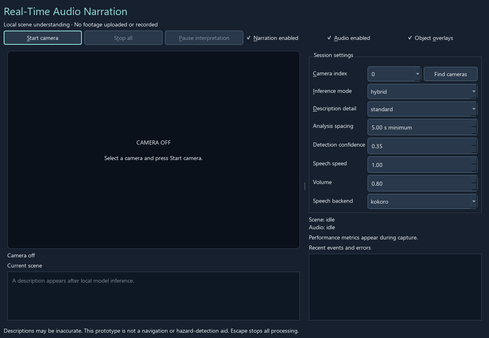
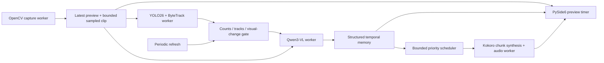

# Real-Time Audio Narration

A local desktop accessibility prototype that interprets webcam scenes and speaks meaningful
changes. Qwen3-VL receives a short sequence of timestamped images so it can describe activities
and interactions. YOLO26 and ByteTrack provide object and movement hints; they do not classify
human actions. No paid API, cloud inference, face recognition, or video recording is used.

The application is intended for exploring descriptions of surroundings with visually impaired
users. Generated descriptions can be wrong or miss events. It is **not a navigation or
hazard-detection aid**. This repository contains actual model adapters, not scripted production
descriptions. Automated tests inject fake backends explicitly.

## Install and run

Use **64-bit Python 3.12** (3.11 also supported). Kokoro 0.9.4 currently excludes Python 3.13,
so the project deliberately limits Python to 3.11–3.12.

```powershell
git clone https://github.com/rakhshethans/real-time-audio-narration.git
cd real-time-audio-narration
powershell -ExecutionPolicy Bypass -File scripts/install.ps1
.\.venv\Scripts\audio-narration.exe
```

The script creates a virtual environment, installs the pinned direct dependencies, downloads
official model weights and prepares English text processing. The initial downloads require
an internet connection and several GB of storage. Repeated setup reuses cached weights.
Nothing is uploaded. Camera access begins only when Start camera is pressed (or Find cameras
is used to probe available devices).

Manual setup, also suitable for Linux/macOS:

```bash
python3.12 -m venv .venv
# Windows: .venv\Scripts\Activate.ps1
source .venv/bin/activate
python -m pip install --upgrade pip
python -m pip install -e '.[dev]'
audio-narration-setup
audio-narration
```

On Windows, use `py -3.12` instead of `python3.12`. The supplied
`requirements-windows-py312.lock.txt` captures the full dependency set resolved in the validation
environment, including the optional system voice. To reproduce it, install it with
`python -m pip install -r requirements-windows-py312.lock.txt`, then install the application with
`python -m pip install --no-deps -e .`. Other operating systems should use `pyproject.toml`.
See [validation](docs/VALIDATION.md) for the actual scope of testing.

### Hardware and system dependencies

* CPU mode is supported, but Qwen may take many seconds per interpretation. A 16 GB RAM
  machine is a reasonable starting point; 32 GB gives more headroom. These are planning
  estimates, not certified minimums. The 2B model uses roughly 8 GB for float32 weights
  alone, with additional memory needed for activations, caches and the other models.
* Budget roughly 8 GB of free storage for weights, plus several GB for Python packages.
  Windows without symlinks and repeated caches may need more. Downloads are not committed.
* NVIDIA acceleration requires a compatible driver and the matching PyTorch/torchvision
  CUDA wheels. Follow the [official PyTorch installer](https://pytorch.org/get-started/locally/).
  The default package install does not guarantee CUDA support on Windows.
* Auto mode selects CUDA, then Apple MPS, then CPU. `audio-narration --device cpu` forces CPU.
  GPU uses float16; CPU uses float32. TTS stays on CPU to limit GPU competition.
* Linux commonly needs `libportaudio2`, `espeak-ng`, `libgl1` and Qt's X11/xcb libraries;
  a desktop display session is needed. macOS needs camera permission and may need
  `brew install portaudio espeak-ng`. Windows wheels bundle PortAudio.
* Misaki's `espeakng-loader` supplies a phoneme fallback on supported platforms. If it fails,
  install [eSpeak NG](https://github.com/espeak-ng/espeak-ng/releases) and set `ESPEAK_LIBRARY`
  to its library path. The Windows Visual C++ 2015–2022 x64 runtime may be required for wheels.
* A webcam and output audio device must be available. Enable OS camera permission and close
  other applications monopolizing the device. Camera indices 0–4 can be scanned; an index
  can also be entered manually. Detection is best-effort, not an inventory of all hardware.

CPU users can increase analysis spacing, keep Brief descriptions, or run without speech.
Automatic expiry is 30 seconds with acceleration and 180 seconds for the reduced CPU profile.
CPU inference uses at most two frames with maximum side 224 pixels. `--max-age 30` enforces
strict freshness on CPU, which can discard every result on slow hardware. A longer expiry
allows delayed descriptions; it cannot turn CPU inference into real-time activity recognition.
CPU loading requires at least 10 GiB available RAM; close memory-heavy applications first.

## Desktop interface

The live feed is independent of model loading and inference. Controls include camera selection,
start/stop, interpretation pause/resume, narration enable, audio mute, object overlays, detail
level, baseline/hybrid selection, confidence, analysis spacing, voice speed and volume.
Session settings take effect on the next start; pause, audio and narration controls act live.
Escape stops the session. Pausing keeps the webcam preview active and cancels queued speech.
Turning off narration stops interpretation; hybrid tracking and preview remain active.

Brief requests concise events; Standard requests activity descriptions; Detailed requests more
observable clothing, objects and relationships. These are prompts, not guarantees about output.
The interface displays the latest description, event history, loading/error status, detected
classes and performance diagnostics. Events and speech actually started are labelled separately.
Controls are keyboard-operable and important status is written in text, not only colour.



## Architecture



Five responsibilities are separated: capture, detection/tracking, VLM inference, temporal
processing and audio. Temporal processing runs after inference in the scene worker because it
is small and avoids another queue. The Qt main thread only renders the preview, handles controls
and consumes queued signals. Models initialize once per camera session, on their workers.

### Detection and temporal interpretation

YOLO26 nano detects its supported COCO classes. ByteTrack associates detections between sampled
frames with `persist=True` and the explicit `bytetrack.yaml` configuration. Normalized boxes,
labels, confidences and optional track IDs are passed to the VLM as fallible hints. IDs are local
to one session, not person identities. Occlusion and sparse sampling can fragment tracks.

The VLM receives up to four ordered images spaced approximately 0.7 seconds apart, reduced to a
maximum side of 448 pixels (two frames at 224 pixels in CPU mode). Timestamps are text labels
accompanying each image; this is a
multi-image sequence, not the model's native video decoder. The prompt asks for visible actions,
relationships and uncertainty, along with JSON fields for persistent facts, current actions and
new changes. Previous structured facts/actions provide limited context. Strict parsing rejects
invalid responses and allows another attempt after the rate limit; raw malformed text is never
spoken. Prompts reduce hallucination but cannot enforce visual truth.

An additional coarse motion-evidence gate restricts unchanged clips to posture and appearance.
It removes common unsupported motion claims and clears transition events from still clips.
This filter was added after an actual still-image response claimed walking; it is heuristic
and can miss subtle actions or pass camera movement. Final prompt/profile validation was
blocked by memory pressure, as recorded in the validation report.

Memory holds 20 structured observations and 40 recent narration candidates. New actions and
facts are compared with the immediately preceding observation, and recent changes are matched
with normalized string similarity. This is a transparent heuristic, not semantic entailment.
Repeated states are suppressed; a new observation replaces the current context to reduce stale
contradictions. Uncertain observations get cautious wording. Scene summaries are eligible after
60 seconds. Summaries are considered only when a successful interpretation arrives.

### Hybrid versus baseline

The primary hybrid mode runs detection at up to 5 Hz. Changes in class counts, tracked centers,
track arrival/loss, or a coarse grayscale grid mark the analysis gate dirty. A minimum interval
(default 5 seconds) bounds expensive calls. A 15-second refresh detects events whose objects stay
in place, such as drinking. Detector signals only request analysis and never become action claims.

Baseline mode bypasses YOLO and requests the same VLM on the same minimum interval. This makes
the comparison useful: hybrid adds detection cost in exchange for fewer interpretations in
stable scenes. Camera motion and exposure changes can trigger excess calls; hybrid is not
automatically faster in every scene. Short actions between samples can be missed in either mode.

### Speech and backpressure

The frame buffer stores one latest frame and four sampled frames; it does not accumulate a
30 FPS inference queue. Pending speech is bounded to three candidates. New candidates replace
older ones of equal/lower priority, stale descriptions expire, and new action events can interrupt
a lower-priority summary. A single consumer synthesizes sentence chunks and plays them sequentially
with sounddevice; it starts playback after the first synthesized chunk instead of waiting for
the full description. Audio writes check cancellation every 1,024 samples (about 43 ms at 24 kHz).
Synthesis itself cannot be forcibly interrupted mid-chunk, but cancelled chunks are not played.
Pause/resume uses a per-inference cancellation token and a session epoch to reject late results.
VLM generation stops cooperatively between decoding steps; model loading/native operations can
take longer to finish. The window remains responsive while shutdown waits for workers and
OpenCV releases the camera.

For a free local fallback, install `python -m pip install -e '.[system-voice]'` and run
`audio-narration --tts-backend system`. It uses the OS voice through pyttsx3, with lower and
platform-dependent quality. This is an explicit option, never a silent replacement for Kokoro.
OS voice licences apply; this project distributes no OS voices.

## Models, caching and privacy

| Component | Pinned choice | Purpose |
| --- | --- | --- |
| OpenCV / NumPy | 4.12.0.88 / 2.2.6 | Capture, image handling, visual-change grid |
| PySide6 | 6.9.3 | Desktop UI and queued cross-thread signals |
| Ultralytics | 8.4.23, `yolo26n.pt` | Detection and ByteTrack integration |
| Qwen | `Qwen/Qwen3-VL-2B-Instruct` | Temporal visual descriptions |
| Transformers / PyTorch | 4.57.6 / 2.8.0 | Local inference with SDPA |
| Kokoro | 0.9.4, `hexgrad/Kokoro-82M`, `af_heart` | English local neural speech |
| sounddevice | 0.5.3 | Sequential cancellable audio output |
| pytest | 8.4.2 | Hardware-independent regression tests |

Exact Hugging Face revisions are in `config.py`. Setup downloads weights only from official
repositories and caches them in `models/`, or the `NARRATION_CACHE` environment variable.
Qwen is loaded with `local_files_only=True`. Kokoro receives local config, weight and voice
paths. The English spaCy model is prepared by setup so first narration does not need an install.
Set `HF_HUB_OFFLINE=1` after setup for stricter offline operation. `.env.example` documents
environment variables; no secrets are required and `.env` is not automatically loaded.
The YOLO file's SHA256 is recorded after download in the local manifest; it is an audit record,
not an independently authenticated checksum. Hugging Face revisions are fixed.

No footage is saved or sent to a service. Frame memory is bounded and cleared when capture ends.
Logs contain worker errors; ordinary frame contents and model descriptions are not logged.
Descriptions and history are held only in application memory. There is no face recognition,
identity lookup or recording feature. Initial package/model setup contacts package hosts.

Optional `.[quantization]` enables bitsandbytes 4-bit CUDA loading with `--quantize`; this path is
not enabled by default and must be benchmarked on the target GPU. ONNX export and SmolVLM2 are
not implemented: adding untested adapters would weaken the reliable primary path. CPU, CUDA,
MPS, reduced resolution and sampled invocation are supported, with platform verification limits
recorded below.

## Tests, evaluation and performance

```bash
python -m pytest -q
python -m ruff check .
audio-narration-benchmark path/to/your/test-video.mp4 --seconds 60 --output benchmark-results.json
```

Tests cover detection conversion, track association signals, scene response validation, bounded
buffers/memory, action changes, repetition suppression, refresh/rate limiting, priority/expiry,
audio cancellation, camera failures, model failures, pause/resume and worker shutdown. See
[manual test protocol](docs/MANUAL_TESTING.md) for real-world activity evaluation. CI runs core
tests on Windows/Linux and Python 3.11/3.12 without downloading weights.

The benchmark replays the same local video in baseline and hybrid modes using real models and
reports detection/VLM latency, invocation frequency per source minute, candidate counts, errors,
sampled RAM and process CPU usage. It is sequential replay, not live webcam throughput; baseline
runs first, so warm-up order is a limitation. It does not measure speech or GPU utilization.
The live UI measures capture FPS, latest inference latency, synthesis chunk latency, first-audio
write latency, frame-to-audio latency, VLM calls/minute and process CPU/RAM. Frame-to-audio is a
proxy from the latest observed frame, not a ground-truth timestamp for the start of an action.
First-audio timing excludes lazy model initialization and measures the first device write,
not physical speaker onset. No unmeasured real-time claims are made.

[Validation report](docs/VALIDATION.md) lists tests actually conducted, measured results and
unverified components. Benchmark outputs and private test videos are ignored by Git.

## Limitations and next steps

Descriptions depend on generative model accuracy; structured output, prompts and detector hints
cannot eliminate hallucination. Static scene text may be paraphrased enough to evade heuristic
deduplication. The memory is not an action classifier or a formal world model. Confidence values
refer only to detections, not to the correctness of generated events. The initial scene is
narrated once and periodic summaries are intentional. A long inference can expire before speech.

Future work should evaluate annotated activity clips, tune gates from measured recall/latency,
add semantic consistency checks, test screen-reader navigation with users, compare the optional
SmolVLM2 model, and benchmark quantization/ONNX on representative laptops. Process isolation
would allow stronger cancellation of native inference than Python threads provide.

## Licensing and acknowledgements

This application is licensed **AGPL-3.0-only**; see [LICENSE](LICENSE). It is intended to remain
open source alongside Ultralytics' AGPL code/weights. Preserve notices and provide corresponding
source under AGPL when distributing covered work or operating modified covered software over
a network. Do not interpret non-commercial use as an exemption from licence obligations.

Model and dependency licences are separate. See [third-party notices](THIRD_PARTY_NOTICES.md),
which also covers Kokoro's voice pack and training-data attribution links. Dependencies and
weights are downloaded by the user, not bundled in this repository. Check their notices when
redistributing binaries or model files. Attribution belongs to Qwen, Ultralytics/ByteTrack,
hexgrad/Kokoro, Hugging Face, PyTorch, OpenCV, Qt/PySide and the other dependency authors.
