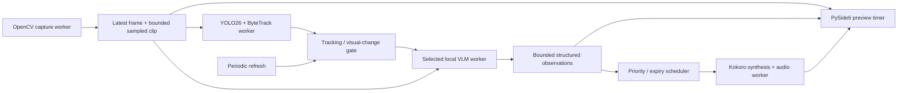

# Real-Time Audio Narration

A local desktop accessibility prototype that interprets webcam scenes and speaks meaningful
changes. Version **0.2.0** uses SmolVLM2 fast mode, YOLO26/ByteTrack and GPU-accelerated Kokoro.
Qwen3-VL remains selectable. No paid API, cloud inference, face recognition or recording is used.
Descriptions can be inaccurate: this is not a navigation or hazard-detection aid.

## Download and run on Windows

1. Install **64-bit Python 3.12** from [python.org](https://www.python.org/downloads/windows/).
2. [Download version 0.2.0 ZIP](https://github.com/rakhshethans/real-time-audio-narration/archive/refs/tags/v0.2.0.zip) and extract it.
3. Double-click **Install-and-Run.bat**. Setup installs dependencies and downloads official weights.
4. Press **Start camera**. Wait for model and speech warm-up; then narration begins.

Use **Run.bat** for subsequent starts. Keep Audio enabled and Narration enabled checked.
The first setup and each application session's warm-up take longer than steady-state inference.
Setup is not a portable executable: Python and one-time library/model downloads are required.

NVIDIA hardware is detected automatically. The installer selects the official CUDA 12.8
PyTorch build and verifies a real GPU operation. A compatible NVIDIA driver is required;
the tested laptop used RTX 5070 Laptop GPU, 8 GB VRAM, driver 617.14. A separate CUDA toolkit
is not required for the supplied wheels. If no NVIDIA adapter is found, setup selects CPU and
warns that it cannot promise narration within seconds. Windows may require the Visual C++
2015–2022 x64 runtime for native libraries.

Allow **12 GiB free temporary disk space for a new CUDA installation**; around 20 GB free is
a useful allowance for a complete new setup. The compressed GPU package is approximately
3.5 GB. Setup checks free space before downloading it. Completed installs and model caches
are reused. Model storage defaults to `%LOCALAPPDATA%/RealTimeAudioNarration/models` on Windows,
so future ZIP versions reuse it; existing `models/` folders and `NARRATION_CACHE` overrides work.

### Manual installation

```powershell
git clone https://github.com/rakhshethans/real-time-audio-narration.git
cd real-time-audio-narration
powershell -ExecutionPolicy Bypass -File scripts/install.ps1
.\.venv\Scripts\audio-narration.exe
```

`scripts/install.ps1 -Backend cuda` explicitly selects NVIDIA; `-Backend cpu` selects CPU.
`-SkipModels` reuses an already-complete cache. To add optional Qwen weights:

```powershell
.\.venv\Scripts\audio-narration-setup.exe --only vlm
.\.venv\Scripts\audio-narration.exe --vlm qwen
```

Linux/macOS: use Python 3.11–3.12, create a virtual environment, install `-e '.[dev]'`, run
`audio-narration-setup`, then `audio-narration`. Select the matching PyTorch GPU wheels using
the [official installer](https://pytorch.org/get-started/locally/). Linux may need `libportaudio2`,
`espeak-ng`, `libgl1` and Qt xcb libraries; macOS needs camera permission and may need PortAudio
and eSpeak NG. The phoneme fallback is bundled on supported platforms; install
[eSpeak NG](https://github.com/espeak-ng/espeak-ng/releases) if it fails. Kokoro excludes Python
3.13, so this project deliberately supports 3.11–3.12.

## Interface

Camera selection/probing, responsive preview, optional tracked-object overlays, current scene,
recent events/errors, pause/resume, audio mute, narration enable, Brief/Standard/Detailed output,
baseline/hybrid selection, scene-model choice, detection confidence, speech speed and volume.
Escape stops processing. Pause keeps preview active but cancels interpretation/speech. Session
settings apply on the next start; mute, narration and pause operate live. Keyboard focus,
mnemonics and textual status indicators are included; screen-reader usability needs evaluation.


## Architecture



Capture, detection, interpretation and speech run independently of Qt. Small temporal processing
runs in the scene worker. The buffer stores one latest frame and two sampled frames, not an
ever-growing webcam queue. Models initialize once per session; loading is serialized to avoid
concurrent Transformers import failures. The preview continues during initialization.

### Detection and scene understanding

YOLO26 nano detects COCO classes; explicit `bytetrack.yaml` and `persist=True` maintain local
tracking IDs. Normalized boxes, classes and confidence are available as fallible hints.
Tracking IDs are not identities, and detections do not establish complex human actions.

Fast mode uses the official **SmolVLM2-256M-Video-Instruct** model on two timestamped images.
It generates a short genuine scene caption. spaCy extracts noun phrases and verb subtrees as
structured facts/actions; this is linguistic parsing, not ground-truth action classification.
Qwen instead generates validated compact JSON observations. Both receive recent context;
prompts request visible interactions, cautious language and no identity/sensitive-trait guesses.
A coarse static-clip guard removes common unsupported motion claims and transition events.
It can miss subtle actions or pass camera motion; hallucinations remain possible.

Temporal memory keeps 20 observations and 40 recent narration candidates. Current structured
facts/actions replace the prior context, and normalized similarity suppresses repeated states
and recent changes. New actions get higher priority; occasional summaries are eligible after
60 seconds. Fast-mode extraction and similarity are heuristics, not semantic entailment.

### Latency and speech

Hybrid mode samples detection at up to 5 Hz. Class-count changes, tracked movement/arrival/loss
and a grayscale grid dirty the VLM gate. Default minimum spacing is one second, with a two-second
refresh for actions that tracking alone may miss. Baseline skips YOLO and uses the same VLM at
fixed intervals. Hybrid is not automatically faster when a scene changes constantly.

Brief mode requests a concise sentence; detailed output may cost more and miss the deadline.
Descriptions expire after **five seconds on every backend**. Decoding receives cooperative
cancellation, and late results are rejected before new speech starts. Native calls may return
later than their deadline; this is not a hard real-time system. The old 180-second CPU exemption
was removed. `--max-age` can override expiry, with a corresponding freshness trade-off.

Kokoro loads and warms a representative sentence before interpretation requests. It uses CUDA
when available/selected, otherwise CPU. Sentence chunks play sequentially through sounddevice;
one consumer prevents overlap, and cancellation is checked every 1,024 samples. Once a sentence
starts within its deadline it can finish; pause/stop/priority interruption still cancel it.
Optional `.[system-voice]` and `--tts-backend system` explicitly use a local OS voice via pyttsx3.
OS voices retain their own licences and are not distributed here.

## Validation and limitations

**41 automated tests passed**, along with Ruff and dependency consistency checks. A real GPU
replay through YOLO26, SmolVLM2, memory, scheduler, Kokoro and the output device measured
**2.109 seconds from sampled frame to first audio write**, with no pipeline errors and clean
shutdown. This is one public still-image smoke check after warm-up, not a worst-case latency,
physical-speaker-onset measurement or activity-recognition benchmark.

Qwen exceeded the five-second deadline on this laptop even with CUDA. CPU Kokoro initially
took about 6.3 seconds for the test sentence; moving speech to CUDA resolved that bottleneck
in the successful check. The smaller scene model sacrifices detail/accuracy for speed.
Moving activities, sustained live webcam use, CPU fast-mode timings, MPS, quantization and
screen-reader accessibility remain unverified. Read [the complete validation record](docs/VALIDATION.md).

```bash
python -m pytest -q
python -m ruff check .
audio-narration-benchmark path/to/test-video.mp4 --seconds 60 --output benchmark-results.json
```

The benchmark uses real models on the same local video, reporting inference latency, invocation
frequency, errors, sampled RAM and CPU usage. It is sequential offline replay; warm-up order
affects results. It does not measure speech or live preview. The UI reports capture FPS, latest
inference/synthesis latency, first-audio-write and frame-to-audio proxies, calls/minute and CPU/RAM.
See [manual testing](docs/MANUAL_TESTING.md) for entry/exit, pickup/drinking, sit/stand, movement,
static-scene repetition, interruption and shutdown checks. Do not commit private test footage.

Next steps: annotated moving-video accuracy/latency evaluation, percentile measurements,
semantic contradiction checks, accessibility user studies and platform-specific optimization.
ONNX export and 4-bit CUDA loading are not validated. The optional quantization setting requires
`.[quantization]` and `--quantize`; it is not enabled by default.

## Privacy, dependencies and licences

Inference is local. No footage is uploaded, saved or used for face recognition. Frames/history
are bounded in memory. Setup contacts official package/model sources; use `HF_HUB_OFFLINE=1`
after setup for stricter offline operation. Model revisions are pinned in `config.py`; weights,
logs, environments and caches are ignored by Git. `.env.example` documents optional variables;
no API keys are needed and `.env` is not automatically loaded.

Core versions: Python 3.11–3.12, OpenCV 4.12.0.88, NumPy 2.2.6, PySide6 6.9.3, Ultralytics
8.4.23, PyTorch 2.8.0, torchvision 0.23.0, Transformers 4.57.6, Kokoro 0.9.4, sounddevice 0.5.3,
spaCy 3.8.16 and pytest 8.4.2. CUDA installs select the `+cu128` builds. The original Windows CPU
lock and licence inventory remain historical snapshots; the installer is the recommended setup.

This source is **AGPL-3.0-only**, accommodating Ultralytics code/weights. Preserve notices and
corresponding-source obligations when distributing covered work or serving modified covered
software over a network. Qwen, SmolVLM2 and Kokoro model files have their separate Apache-2.0
terms; Qt/PySide and other dependencies retain their own licences. Weights and libraries are
downloaded, not bundled. See [LICENSE](LICENSE) and [third-party notices](THIRD_PARTY_NOTICES.md),
including voice-pack/training-data attribution and binary-redistribution requirements.
